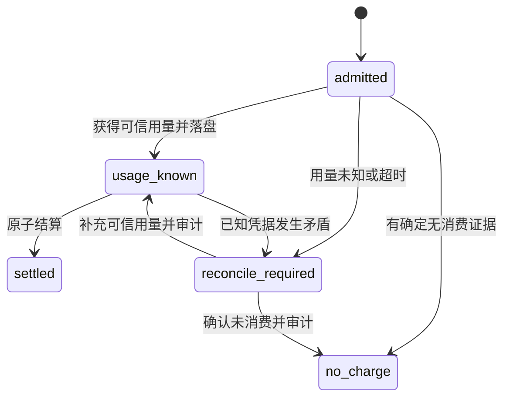

# Claude 周卡计费与恢复协议

## 服务接口

以下为签名草案，具体包内命名可按现有习惯调整，语义不可删减。

```go
type SubscriptionQuotaGatewayBilling interface {
    Admit(context.Context, AdmitTermInput) (*SubscriptionTermSnapshot, error)
    PersistKnownUsage(context.Context, *SubscriptionTermSnapshot,
        decimal.Decimal, json.RawMessage) error
    MarkNoCharge(context.Context, *SubscriptionTermSnapshot, NoChargeEvidence) error
    MarkReconcileRequired(context.Context, *SubscriptionTermSnapshot, string) error
}
type SubscriptionQuotaRepository interface {
    OpenTerm(context.Context, OpenTermInput) (*OpenTermResult, error)
    CancelTerm(context.Context, CancelTermInput) (*CancelTermResult, error)
    ApplyUsageDebitTx(context.Context, *sql.Tx, TermUsageDebit) error
    MarkSettledTx(context.Context, *sql.Tx, SettlementIdentity) error
    ClaimRecoverable(context.Context, RecoveryClaim) ([]KnownTermReceipt, error)
}
```

Snapshot 必须包含 request_row_id、request_id、user_id、api_key_id、group_id、subscription_id、term_id、admitted_at、pricing_at、pricing_snapshot_hash、schema_version。返回和放入 context 时复制，不能引用可被其他请求修改的共享 Group 或 Subscription 指针。

## 并发锁顺序

新领域使用命名空间 subscription-quota:user:group 的 pg_advisory_xact_lock(hashtextextended(...,0))。它只串行化同一用户同一 Claude 分组的短事务，不使用 carpool 全局 scope 锁，不在上游请求期间持锁。

新领域所有写入遵循：

1. 支付场景先遵循既有订单行锁协议；领域内不得反向去锁 payment_orders。
2. 获取用户分组事务锁。
3. 管理操作幂等记录或计费 dedup。
4. 父订阅行。
5. 卡期行，多个卡期按 ID 排序。
6. 请求行。
7. 如本操作确需校验或修改，按固定顺序锁 user、group、api_key 以及账号计数行；单个事务不能持这些锁后再等待第 2 至 6 步。

关键兼容规则：原生订阅方法必须在进入旧的 parent FOR UPDATE 事务前分派 term 模式。支付 term 分支在原生 assignOrExtendSubscription 之前分派。不得在已有反向锁事务里套调用新服务。

GPT 开通持有用户和 Key 锁时，可读取 Claude 分组模式用于共存校验，但不能再请求 Claude scope、parent、term 或 request 锁。否则会与“Claude 结算持 term 后更新 Key”形成环。运行真实 PostgreSQL 并发测试验证，不能只靠文档锁顺序宣称没有死锁。

恢复认领只在单独短事务内使用请求行的 FOR UPDATE SKIP LOCKED，提交认领租约后，才执行新的结算事务；不得持请求锁等待 scope 锁。

## 准入协议

1. 中间件确定不可回退的 term 模式，检查用户、Key、组状态和模型白名单；缺少服务依赖返回 503。
2. 获取已有用户并发槽并完成必要排队。最终准入必须放在实际上游发送之前，不能仅使用排队前检查结果。
3. 为本次真实 HTTP 调用生成服务器 request_id。客户端重复传相同 request ID 仍是不同消费请求。
4. 开启短事务，按锁顺序找到或锁住父订阅、覆盖当前时间的卡期。检查组仍为 anthropic subscription term。
5. 重新读取数据库时钟、用户和 Key 状态、Key 限额、有效期、取消状态及 used_usd 加同卡已知待结算费用。无卡或额度已耗尽拒绝；当前卡存在待核查请求则暂停新准入。
6. 固定归属和计价时间，插入 admitted 请求，提交后才允许调用上游。
7. 等锁期间跨过卡期边界，整体回滚重选；不能持有旧卡身份套新时间。允许一次受限重选，仍无法稳定则返回可重试错误。

无卡拒绝不创建消费流水。准入事务失败不得调用上游。元数据接口可读到期状态，但不能因此允许生成。

## 上游调用与失败切换

- 同组不同账号的确定性无费用失败可继续现有重试，沿用本次归属。
- 已产生用量或已向客户端输出内容，不得把同一计费身份再当成一个免费新请求转发。
- 无法确认旧尝试是否消费的失败进入 reconcile_required；不得将“超时”解释为零费用。
- 如果后续要支持一次用户请求产生多个独立收费尝试，必须设计子尝试身份和汇总，不能复用一个 dedup 键覆盖多笔费用。
- 不允许跨组余额兜底或 ForcePlatform 改写实际计费范围。路由和 API 配置两侧都校验。
- 首次账号选择后、转发前保存 pricing_snapshot，随 admitted 同事务提交。快照含版本、请求及映射模型、计价模型选择规则、适用模型价格表、输入/输出/缓存/长上下文价格、用户组与高峰倍率、缓存 TTL 分类规则；只保存本次计费需要的定价数据，不复制凭据。pricing_at 由最终准入时钟固定，高峰倍率也在该时点解析。
- 定价快照通过现有定价服务的只读解析接口产生。复用同一计算规则；新 term 路径的结算读取快照，不再次从可变配置读取价格。response_model 模式的候选价格和采纳规则也要冻结；无法覆盖的模型不能默认为免费。
- 同组确定无消费重试继续使用冻结的用户定价规则，最终账号统计规则按实际账号保存到 known receipt。若账号切换会改变用户定价语义，必须在 I0 明确映射并测试；无法证明等价时终止本次重试，不偷换规则。
- 恢复 usage_known 使用已冻结金额；人工补充未知用量使用 admitted 时冻结的定价快照，不能按当前套餐或当前模型价格重算。

## 已知用量落盘

必须从真实 usage 计算 ActualCost。服务端现有模型定价、用户分组倍率和优惠规则继续生效；不把上游账户成本当用户费用。

构建版本化凭据，包含量化后的费用、Key 和账号计数、所有归属、请求指纹及重建 usage_log 所需的非敏感字段。先独立事务保存 usage_known，再调用 Apply。客户端断连不取消这一持久化工作；使用有界后台 context。

相同请求再次提交相同凭据为幂等；同请求不同费用或身份为冲突，并进入人工核查。凭据必须拒绝 NaN、Infinity、负费用、非法精度和不匹配快照。现有 Normalize 是格式与量化过程，不是新来源的合法性验证器；旧成本计算的报错返回零路径也不能用于新模式。

已知零费用合法，仍有完整快照和 settled 事实。未知费用必须保持 NULL。

## 原子结算

UsageBillingCommand 增加 SubscriptionTermSnapshot 和 SubscriptionTermCost。BalanceCost、原生 SubscriptionCost、CarpoolSnapshot 和新 term snapshot 四类互斥；term snapshot 存在时，即使金额为零，也属于独立来源。

新模式必须走统一 repository，不允许 legacy 多写兜底。Apply 的新分支在同一数据库事务完成：

1. 获取 scope 锁和 existing dedup claim。
2. 锁 parent、原 term 和原 request；验证保存的凭据、ID、指纹及金额。
3. 追加一条 usage_debit。
4. 增加原 term.used_usd 和 revision；parent.quota_revision 只用于排期变动，此处不递增，避免正常消费使管理员续卡预览持续失效。
5. 沿既有顺序增加 Key 配额和必要账号统计计数；这些是限制及成本计数，不是其他余额来源。
6. 标记请求 settled，提交。

不得写 users.balance、frozen_balance、原生订阅日周月金额或 carpool_*。账户统计可以保持既有规则，但不能按另一供应商的共享用户额度去扣。

重复 Apply 必须校验 dedup 指纹，并核对原流水和请求已用事实，再收敛请求状态。不能仅看到 dedup 就无条件标记成功；去重记录、流水和金额矛盾时进入异常队列。

## 统计日志与账本

现网 usage_logs 在账务事务外写入，本次不为新功能重写全部 GPT 统计事务。新模式：

- 账务真相是专用 ledger 和请求凭据。
- Apply 成功后按固定 request_id 加 api_key_id 幂等写 usage_logs，附带 subscription_term_id 和 subscription_quota_request_id。
- 日志失败不能重新扣费。恢复任务只处理 usage_log_recorded_at 为空的 settled 请求，从 usage_log_payload 补写统计及既有聚合，再标记写入完成；清理兼容见 integration-contracts.md。
- 只有 settled 才写成功 usage_logs；usage_known 和 reconcile_required 通过专用请求查询显示，不写成零费用成功日志。known receipt 的统计投影必须在结算前持久化，补写失败持续重试。
- 查询和对账同时区分 usage_known、settled 和统计缺失，不能只对比一个总额。

## 恢复状态机



恢复只自动处理 usage_known。admitted 超时转核查，不自动扣估计费用。每条恢复使用独立超时；某条失败不能取消后续条目。多副本通过 SKIP LOCKED 加租约避免重复工作，过期租约可以重认领；Apply 幂等仍是最终防重。

首版建议恢复批次 100、扫描间隔 30 秒、每笔最多 5 秒、指数退避到 5 分钟；这些是工程默认值，可配置，不代表容量测量。普通暂时故障即使多次重试失败，仍保持 usage_known，告警并退避，不能降级成未知或免单。只有事实矛盾转核查，原已知凭据仍不可覆盖。

已解决的 known receipt 可以使 closing 卡关闭。未知凭据需人工提供上游用量或无收费证据；禁止直接把金额写零、删请求、重置旧卡或借 GPT 补账。

人工 resolve 只允许 reconcile_required 且尚无已知金额及原凭据的请求。已有可信凭据发生矛盾，必须保留原事实并进行专门账务审查；首版不能用通用 resolve 把它改零或换一份费用。结算只验证保存的归属和凭据，Key 后续停用、卡已取消或组维护不免除已准入费用。

## 管理开卡和支付幂等

管理员请求规范化后用 scope 加 Idempotency-Key 查原结果。相同载荷返回原结果；不同载荷返回 409。然后才检查 expected_revision 和最新排期，避免成功操作重放时因版本变化误判失败。

开卡、操作结果、parent 摘要和失效 outbox 同事务。支付另有 payment_order_id 唯一约束，新 term 权益与订单发放审计在专用 SQL 事务提交，再由原履约状态机收敛 completed；具体锁和租约校验见 integration-contracts.md。禁止“回调先成功后异步开卡”丢权益。

新模式 order_snapshot 缺失时拒绝履约并进入可恢复失败，不能读取当前默认额度猜测当时购买金额。

