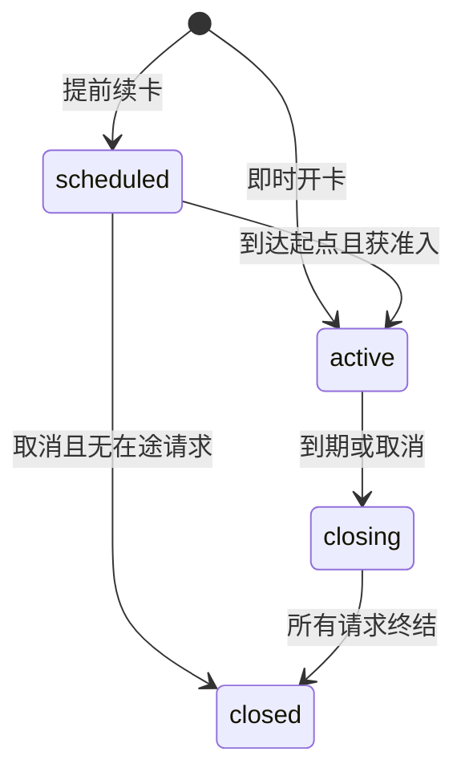

# Claude 周卡数据模型

## 结构变更

[SQL 结构草案](contracts/schema.sql.example)是正式迁移的输入，不是可直接发布的迁移。Sol 必须结合生产迁移清单选择新的文件号，不修改已有文件及校验和。

| 现有表 | 增量 |
| --- | --- |
| users | claude_subscription_concurrency 可空正整数，独立用户并发覆盖；原 concurrency 保留 |
| groups | subscription_quota_mode，默认 windows，term 限 anthropic subscription |
| user_subscriptions | quota_revision，默认 0，仅开卡、续卡、取消等排期变动递增；增加身份复合唯一键供新表外键使用 |
| subscription_plans | term_quota_usd，可空；新模式在售商品必须有正额度且时长 7 天 |
| payment_orders | subscription_quota_snapshot JSONB，可空；旧订单保持原路径 |
| usage_logs | subscription_term_id 与 subscription_quota_request_id，可空，原历史不回填 |

保持 BillingTypeSubscription 等于原值 1。新模式通过额外来源字段区分，不重新解释历史 billing_type。billing_usage_entries 是已有历史基础设施，不能把它误认为新领域的权威流水；当前实时 Apply 使用 usage_billing_dedup，调用锚点为 S13 至 S16。

## 四张新表

### subscription_quota_terms

每行代表一张不可拆分的七日卡。

| 字段 | 类型与约束 | 语义 |
| --- | --- | --- |
| id | BIGINT 主键 | 永久卡期身份 |
| subscription_id user_id group_id | BIGINT，复合外键 | 三者必须与父订阅一致 |
| term_no | 正整数，父订阅内唯一 | 稳定顺序，不因取消重排 |
| quota_usd | NUMERIC(20,8)，大于零 | 开卡冻结额度 |
| used_usd | NUMERIC(20,8)，大于等于零 | 已结算流水净额，可超过额度 |
| starts_at expires_at | TIMESTAMPTZ | 固定连续 168 小时，不因人工取消改写 |
| lifecycle_state | scheduled active closing closed | 用于维护及结算，不独立决定可用性 |
| cancelled_at | 可空时间 | 非空立即停止新准入，不追溯取消已准入消费 |
| closed_at | 可空时间 | 无未解决请求后才可标记完成 |
| revision | BIGINT | 变更投影版本 |
| source_kind | admin payment | 额度来源不是资金钱包来源 |
| source_plan_id | 可空 BIGINT | 仅追踪，不依赖商品仍存在 |
| source_snapshot | JSONB | schema_version、额度、时长、商品显示名称等，禁止凭据 |
| payment_order_id | 可空、唯一外键 | 一个支付订单至多对应一张卡 |
| created_by | 可空管理员 ID | 系统履约为空，source_kind 标识系统来源 |

额度、归属、起止时间、term_no 和来源快照创建后不可更新。used_usd 只由专用结算或经过审计的纠正事务更新；服务账户不能随意 UPDATE/DELETE 流水。

父记录 starts_at 和 expires_at 只作为兼容摘要。term 模式的准入查询必须找到覆盖当前时刻且未取消的具体卡期，不能因父记录的远期到期时间误放行中间空档。

### subscription_quota_requests

保存真实请求的卡期归属和可重放的计费事实。

- request_id 使用服务端生成的 subquota:UUID。不能使用客户端 request ID、提示词 hash 或上游重复 ID 去重真实新调用。
- 唯一键为 request_id 加 api_key_id；另有 id 加 term_id 复合唯一键供流水和用量日志约束。
- 归属包含 subscription_id、term_id、user_id、group_id、api_key_id；复合外键阻止拼错用户或卡期。
- admitted_at 使用锁等待后的数据库时间；pricing_at 固定计价时点；pricing_snapshot 保存转发前解析的定价规则和版本。
- status 为 admitted、usage_known、settled、no_charge、reconcile_required。
- revision 每次状态、凭据或核查结果变化递增；人工 resolve 用此版本做条件更新。worker 租约续期不改变业务 revision。
- actual_cost_usd 在未获得可信用量前必须为 NULL。零与未知严格区分。
- billing_payload 是带版本的规范化结算命令，含用户实际费用、账号费用、Key 计数、模型及 token 统计；不保存原始提示词、Authorization 或 API Key。
- recovery_attempts、next_retry_at、lease_until、lease_owner、last_error_category 支持多实例恢复。worker 租约只是执行控制，不赋予新的消费权。
- usage_log_payload 保存可重建统计行的脱敏投影；usage_log_recorded_at 标识统计已成功写入。后台只补尚未写成功的统计，不重复扣费，也不补回之后按策略清理的历史日志。

### subscription_quota_ledger

追加式消费事实。字段包括 term_id、request_row_id、event_key、entry_kind、delta_used_usd、reverses_entry_id、actor_id、reason、created_at。

- usage_debit 的 delta 大于等于零，已知零费用也有稳定结算事件。
- usage_reversal 的 delta 小于零，必须引用同一张卡的原流水；首版不开放任意金额修改 UI。
- event_key 唯一，例如 usage:请求行ID；同一请求只能有一个 usage_debit。
- term.used_usd 必须等于该卡所有 delta_used_usd 的精确和，不使用浮点容差掩盖差额。
- 取消或自然到期不产生假消费流水；历史未用额度仍可解释，当前可用由时间和取消状态计算。
- 应用路径禁止 UPDATE/DELETE；迁移中添加防变更触发器并测试。纠错追加反向事件，不改旧行。

### subscription_quota_operations

保存开卡、续卡、取消等管理员操作的幂等结果。包含 idempotency_scope、idempotency_key、operation_kind、actor_id、request_fingerprint、result JSONB、created_at。

scope 包含动作、目标用户和分组；管理员 scope 还包含管理员身份。支付履约使用 payment:order:订单ID，不能随回调节点改变。唯一键为 scope 加 key。规范化指纹包括目标、固定八位额度、模式、时长、套餐快照版本和请求前置版本。

业务写入和操作结果必须在同一事务提交；事务失败不留下“已成功”的操作。重放先检查原结果，后检查当前权益状态，确保到期后的相同开卡重试仍返回原卡。

## 周期和状态投影

用户状态由服务端计算：取消优先；未到起点为 scheduled；到期为 expired；有效期内有待核查为 reconciling；已用加已知待结算达到额度为 exhausted；其他为 active。closing 是账务维护状态，不延长可用时间。active 字段陈旧不能穿越 expires_at。

同一父订阅的未取消时间区间不能重叠。所有写路径必须先拿 user_id 加 group_id 的数据库事务锁，再检查区间并插入。首版不依赖 btree_gist 扩展；不授予业务客户端直接 INSERT 表的能力。并发开卡和支付回调必须证明不会产生重叠。

## 时间和金额的确定性

1. UTC 保存，展示转换时区；区间为左闭右开。
2. 锁等待结束后用 clock_timestamp() 复核准入时间，不使用事务开始时的 NOW() 判断边界。
3. 后扣费用在生成新模式凭据时使用现有八位量化规则一次量化，流水、卡已用、Key 计数和统计使用同一值。
4. 原来源的指纹计算顺序不能更改；新来源使用独立版本，固定十进制表示后签名。
5. 源码旧日周月字段有十位小数，不照搬为新结算标准；现网真实统一计费规则是八位。

## 取消和续卡

- 续卡永远创建新 term。当前卡耗尽不自动激活未来卡。
- 取消中间未来卡不前移其他未来卡，保留已承诺时间。
- 取消当前卡后新开卡可以从当时开始，但已准入请求仍归旧卡；不得清零旧卡 used_usd。
- 已知但未结算请求必须先恢复后关闭历史卡。未知请求可使历史卡保持 closing，并告警。
- 旧订阅软删除、restore、reset、直接延长天数不能用于新模式。需要明确领域操作，防止重新发放旧卡额度。

