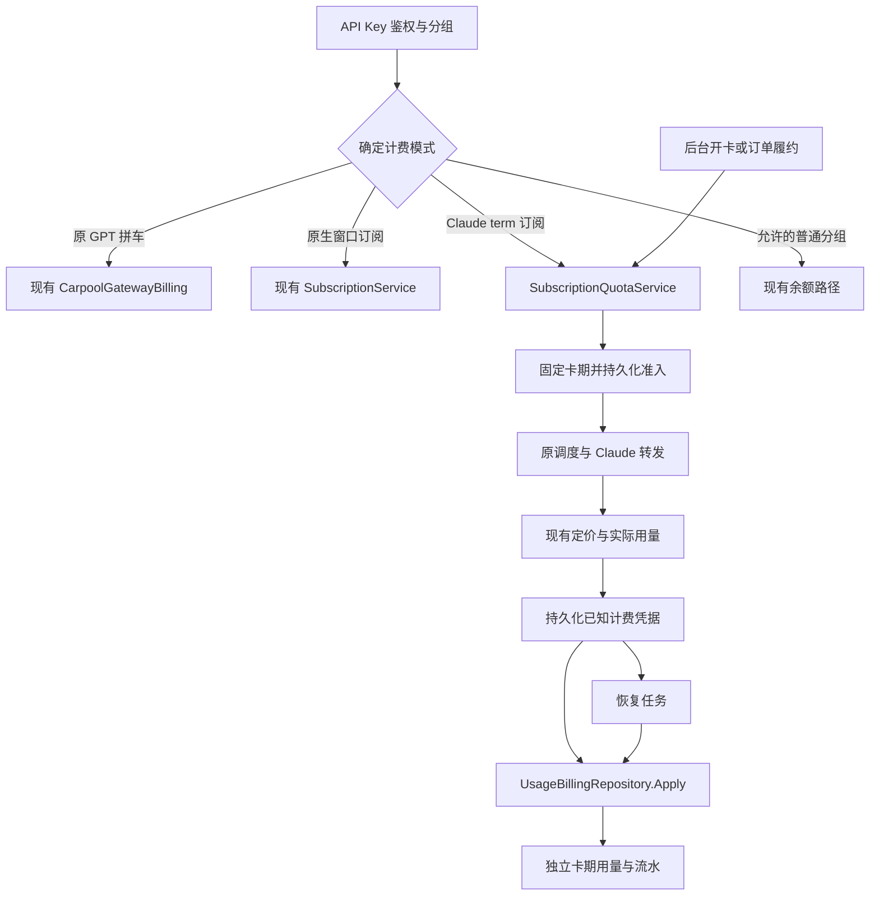

# Claude 独立周卡总体架构

## 设计原则

在现有单体内部划出订阅额度领域。领域服务负责卡期和用量不变式，Repository 负责事务与锁，Handler 只做认证、参数和响应映射。费用计算沿用现有定价服务；新领域接收已经确定的费用，不复制模型价目表。

为隔离账务保留独立的订阅流水，为减少重复复用用户、分组、订阅父记录、订单、计费去重和现有定价。避免把所有计费重构成一个全新通用钱包，也不把 Claude 周卡塞入 carpool_terms。

## 模块图

四个分支互斥。GPT 路径不经过 Claude Repository。共享计费入口只增加一个新的受校验分支，旧分支的指纹、金额和顺序保持兼容。

## 计费模式选择

新增 groups.subscription_quota_mode，允许 windows 和 term，默认 windows。只有 subscription_type 等于 subscription 且 platform 等于 anthropic 的分组可以设置 term；数据库 CHECK 与服务端校验都要实现。

决策顺序：

1. 按当前 Key 的真实分组和有效的用户绑定识别 GPT 拼车。绑定匹配才投影，过期绑定也保留防余额回退。
2. anthropic 加 subscription 加 term 进入新领域；即使无卡、卡过期、服务未注入，也保持该模式并拒绝，不能落入下一个分支。
3. 其他 subscription 加 windows 保持原生订阅。
4. 原本允许的 standard 分组沿原余额逻辑；GPT 拼车会员不得因为本次修改获得未授权标准分组访问权。

模式不能由请求模型字符串、客户端字段或请求路径决定。Group 共享对象不可就地修改；DTO 中使用显式 quota_mode 和 quota_summary，不伪造 group.weekly_limit_usd。

## 逐用户拼车绑定兼容

当前 carpool_billing_bindings 的 user_id 主键足以保留一个 GPT 绑定，不改为通用多钱包关系表。

修改 api_key_repo.projectCarpoolBilling：

- 没有 GPT 绑定：维持原分组行为。
- Key 匹配绑定的 OpenAI standard 分组：维持原 carpool 投影。
- Key 指向 anthropic subscription term 分组：保留 Claude 订阅模式，交由新领域判断当前权益。
- 其他分组、空分组、错误平台或数据库错误：维持拒绝。

此例外不依赖“当前卡有效”才能识别模式，否则到期后的 Key 可能退回余额路径；可用性由 Claude 准入决定。

修改 prepareCarpoolUserGroupTx 的全部 Key 校验：允许上述明确的 Claude term Key 与 GPT Key 并存。不得删除、改分组或迁移 Claude Key；继续拒绝无分组 Key、其他 OpenAI standard Key 和任意普通余额分组 Key。

保留 GPT 首次开通普通余额及冻结金额必须为零、原绑定必须一致等要求。user_allowed_groups 的旧清理只保留原防绕过目的，不用它发放 Claude 额度；有效 term 订阅自身提供可见性。检查开通和续费两条路径，不能只修鉴权。

## 领域和依赖方向

新增最小组件：

| 组件 | 职责 | 不得承担 |
| --- | --- | --- |
| SubscriptionQuotaService | 开卡、排期、取消、读投影、调用 Repository | 模型计价、直接修改拼车 |
| SubscriptionQuotaGatewayBilling | 准入、已知用量保存、标记核查 | 业务支付、余额充值 |
| SubscriptionQuotaRepository | PostgreSQL 事务、流水、请求状态、并发约束 | HTTP 响应或 Redis 可用性决策 |
| SubscriptionQuotaRecoveryService | 恢复已知凭据、识别陈旧请求、对账告警 | 推测未知费用、自动扣其他来源 |
| SubscriptionQuotaAdminHandler | 管理员认证、参数校验、操作审计 | 绕过领域写数据库 |
| SubscriptionQuotaQueryHandler | 当前用户的卡期和用量查询 | 暴露他人或上游凭据 |

接口放在 service 端供调用方依赖，金额与快照类型放 domain。具体文件和签名在 [计费协议](billing-protocol.md) 中。构造和清理由 cmd/server/wire.go 接入；后台恢复开关独立于 CARPOOL_BACKGROUND_ENABLED。

## 数据所有权

- groups：路由、模型白名单和订阅额度模式。
- user_subscriptions：现有用户与分组的订阅父记录，提供身份和已有列表兼容；term 模式下旧日周月计数不再是金额来源。
- subscription_quota_terms：每张卡的不可变额度和有效期，以及可对账的已用投影。
- subscription_quota_requests：每次真实上游调用的归属、持久用量凭据和恢复状态。
- subscription_quota_ledger：追加的真实消费与纠正记录。
- subscription_quota_operations：管理操作的幂等、审计和原始结果。
- subscription_plans 与 payment_orders：可选默认额度和不可变订单快照。

所有金额归属以服务器冻结的 user_id、group_id、subscription_id、term_id 为准；数据库复合外键防止跨用户挂账。结构草案属于领域约束设计，不能替代正式迁移审查。

## 请求边界

Messages、Chat Completions、Responses 的现有 Anthropic 转换入口统一调用新准入。HTTP 路径别名也必须接入同一逻辑。非流式与 SSE 共用计费流程。

只放行已接入准入和结算的 Claude 能力。OpenAI Responses WebSocket、独立图片、视频、Grok 搜索、Google/Antigravity 强制平台路由以及未来新增收费入口，未适配新模式前明确拒绝 Claude term Key，不能绕过或按余额计费。这不改变这些端点对原 GPT Key 的既有行为。

同分组账号故障切换保持同一卡期与计费身份；不得因为错误兜底切到另一个普通余额分组。新模式禁止配置 fallback_group_id 和 fallback_group_id_on_invalid_request；运行时再次验证，防止缓存或旧配置漏过。

## 现有订阅维护兼容

windows 模式走原日周月维护。term 模式不调用原 CheckAndResetWindows、AdminResetQuota 或直接 ExtendExpiry，不能按 7 天周期清零历史已用。

原 GET /subscriptions 可继续返回父记录，但必须附带新模式的当前卡投影。原服务中的开通、延长、撤销、恢复、批量操作、兑换及支付退款必须按模式分派；没有专用实现的动作返回明确不支持，不得顺着旧逻辑执行。

取消当前卡只停止新准入，已准入用量继续结算，未来卡原时间不自动前移。父记录 starts_at/expires_at 是兼容摘要，不能用它代替当前卡查询。

## 缓存

新准入最终查 PostgreSQL，不以 Redis 余额作为授权事实。新增只读摘要缓存包含 scope、term_id、revision、server_time 和有效期，Redis 故障回退数据库。

API Key 鉴权快照增加 quota_mode 并提升 snapshot version；不得只更新新字段而接受旧快照。新模式开关、分组模式、撤销和用户状态变更必须清理 L1/L2 并使用现有 outbox。旧 GPT 缓存键和投影语义保留。

缓存提交后失效失败不回滚已经完成的开卡。依靠持久 outbox 重试；每次准入的数据库复核保障不会依赖陈旧允许状态。

## 回退设计

R1 兼容版本识别 term、能阻止旧操作、兼容两类 Key，并在额度实现不可用时拒绝 Claude 新请求。R2 加入完整账务并通过验收；启用指定生产分组是独立配置步骤，不另称一个程序版本。

激活后必须回退到至少 R1，且先关闭新准入、排空并恢复已知消费。直接切回 .13 会丢失 mode 识别和双 Key 兼容，不能当成日常回退。详细状态矩阵在 [迁移及发布](migration-rollout.md)。

